# agent-config

Lorenzo Graizzaro's personal **agent config + skills hub**: one repo that configures every
coding AI he uses (Claude Code, Codex CLI, Cursor, Google Antigravity/Gemini) the same way,
plus the on-demand skill library they all share.

Two things live here, and they're both "always available, loaded only when needed":

- **Config** (`config/`) — instructions, path-scoped rules, lifecycle hooks, and the three
  model-pinned subagents. Symlinked into `~/.claude/` and `~/.codex/` by `install.sh`.
- **Skills** (category directories below) — `SKILL.md` files loaded on demand when their
  `description` matches the task, mirrored flat into `~/.claude/skills` by `sync.sh`.

Neither of these makes a project well-run on its own — see ["How it works"](#how-it-works)
for the second, per-project layer (`project-init`) that does the actual enforcement.

## Install

```bash
git clone https://github.com/LorenGrz/agent-config ~/.agents/skills
~/.agents/skills/install.sh
```

Re-run `install.sh` any time — it is idempotent and never deletes a real file (see
[Install / update workflow](#install--update-workflow)).

## Repository layout

```
.
├── install.sh            # creates/repairs all symlinks, merges settings.json, runs sync.sh
├── sync.sh                # rebuilds the flat ~/.claude/skills mirror from <category>/<skill>/
├── README.md               # this file
│
├── config/                 # global, agent-facing config — see config/README.md
│   ├── AGENTS.md            # agent-agnostic instructions (Codex reads this directly)
│   ├── CLAUDE.md            # @AGENTS.md + Claude Code-only sections, kept ≤60 lines
│   ├── settings.base.json   # sanitized base merged into ~/.claude/settings.json
│   ├── agents/               # scout.md, worker.md, reasoner.md — model-pinned subagents
│   ├── rules/                # path-scoped conventions (typescript.md, react.md, ...)
│   ├── hooks/                # lifecycle shell scripts wired in settings.base.json
│   └── rulesync/             # multi-AI generation for Cursor / Antigravity — see below
│
├── docs/
│   └── decisions/            # ADRs for this hub's own structure (0001-single-repo.md, ...)
│
├── aws/                    # AWS skills, folded in via `git subtree` (ADR 0001)
├── development/            # building features (React, Next.js, NestJS, TS quality, ...)
├── devops/                 # repo/release lifecycle — includes project-init (see below)
├── quality/                # review and tests
├── security/               # auth, prompt-injection defense
├── productivity/           # non-code deliverables (CV, email, meeting notes, ...)
├── meta/                   # how Loren works (roadmap-coach, team-*-agent, ...)
│
├── apexlang -> ~/projects/oracle-skills/apex/apexlang   # external, gitignored
├── omarchy -> /usr/share/omarchy/.../omarchy             # external, ships with Omarchy
└── diagnose-crash -> /usr/share/omarchy/.../diagnose-crash
```

## Categories

| Category | Skills |
|---|---|
| `aws/` | `sam-deploy`, `lambda-patterns`, `iam-least-privilege`, `cost-optimizer`, `serverless-scanner` |
| `development/` | `api-contract-design`, `code-documenter`, `database-persistence-patterns`, `debug-assistant`, `frontend-design`, `nest-module-generator`, `nextjs-ssr-frontend`, `react-native-mobile`, `react-scalable-frontend`, `regex-builder-explainer`, `typescript-code-quality`, `typescript-project-starter` |
| `quality/` | `code-review-safety`, `execute-test-suite`, `react-component-validator`, `unit-test-generator` |
| `devops/` | `conventional-commit-generator`, `project-init`, `repository-context-maintainer`, `run-docker-environment` |
| `security/` | `auth-security-basics`, `prompt-injection-defense` |
| `productivity/` | `ats-resume-formatting`, `cv-linkedin-optimizer`, `meeting-notes-organizer`, `presentation-prep`, `professional-email-drafter` |
| `meta/` | `codex-workflows`, `english-prompt-coach`, `roadmap-coach`, `team-architect-agent`, `team-implementer-agent`, `team-reviewer-agent` |
| external (symlinked, not vendored) | `apexlang` (Oracle APEX), `omarchy`, `diagnose-crash` (ship with Omarchy) |

Each skill's `SKILL.md` has the one-line purpose in its `description` frontmatter; browse
the directories above for the full list with links, or run `rg description */*/SKILL.md`.

## How it works

Two independent layers. Neither needs the other, but most real repos want both.

### Global — always active, in any folder, zero setup

What's active depends on when it loads, not whether it's "installed":

| Loads | When | Where it comes from |
|---|---|---|
| `CLAUDE.md` / `AGENTS.md` | Every session, in full, before the first message | `config/CLAUDE.md` (Claude Code), `config/AGENTS.md` (Codex, others) |
| Skills | Description only, until the task matches and the model invokes it | `~/.claude/skills/<name>/SKILL.md`, flat mirror of `<category>/<skill>/` |
| Rules | Only when a touched file matches `paths:` frontmatter | `config/rules/*.md` |
| Hooks | Executed by the harness at a lifecycle event — **not** read by the model | `config/hooks/*.sh`, wired in `~/.claude/settings.json` |
| Subagents (`scout`/`worker`/`reasoner`) | Dispatched explicitly, each with its own model pin | `config/agents/*.md` |
| Auto-memory | Loaded by the harness at session start, outside this repo | `~/.claude/projects/.../memory/` |

Hooks, concretely (event → script):

| Event | Script | Does |
|---|---|---|
| `PreToolUse` (Edit/Write/MultiEdit) | `guard-omarchy.sh` | denies edits under `~/.local/share/omarchy/` |
| `PreToolUse` (Bash) | `scout-readonly.sh` | inside the `scout` subagent only: allows read-only commands, denies writes |
| `PostToolUse` (Edit/Write/MultiEdit) | `format-file.sh` | runs the project's own formatter/linter on the edited file |
| `Stop` | `stop-git-status.sh` | shows uncommitted changes when in a git repo |
| `InstructionsLoaded` | `log-instructions.sh` | logs what got loaded to `~/.claude/logs/instructions-loaded.log` |

Symlink map (`install.sh` creates/repairs these; see `config/README.md` for the full list):

```
~/.claude/CLAUDE.md ──┐
~/.claude/rules ───────┼──► ~/.agents/skills/config/{CLAUDE.md,rules,hooks,agents}
~/.claude/hooks ───────┤
~/.claude/agents ──────┘
~/.codex/AGENTS.md ───────► ~/.agents/skills/config/AGENTS.md
~/.claude/skills/<name> ──► ~/.agents/skills/<category>/<name>/   (flat mirror, via sync.sh)
```

### Per-project — `project-init`, once per real repo

The global layer only *guides* a model. It can't stop a human, a different AI, or a model
having a bad day from skipping it — instructions are advisory, not enforced. `project-init`
(`devops/project-init/`) scaffolds a repo so the standards hold regardless of who or what is
driving:

| Adds | Why |
|---|---|
| Project `AGENTS.md` (+ thin `CLAUDE.md` pointer) | one source of truth any AI reads, not a Claude-only doc |
| `.claude/settings.json` with superpowers + branch/lint hooks | this project's Claude Code picks up spec-driven workflow + guardrails automatically |
| ESLint (type-aware: `no-explicit-any`, `no-floating-promises`, ...) + strict `tsconfig` | a human or any AI can turn these off in a prompt; they can't turn off a lint/build failure |
| Git pre-push hook + CI (`ci`, `secret-scan` via gitleaks) | enforcement that runs even if nobody reads `AGENTS.md` at all |
| `scripts/gh-flow.sh` | `start`/`pr`/`merge`/`release` — same branch flow every repo, no re-deciding |
| GitHub Project v2 (backlog, labels, protected branch) | work is tracked as issues, not lost in chat history |
| `docs/` layer: `.agents/CONTEXT.md`, `docs/architecture.md`, `docs/decisions/` (ADRs), `docs/superpowers/{specs,plans}/`, `docs/plans/HANDOFF.md` | a new session reads docs instead of re-deriving the codebase; see the global docs rule in `AGENTS.md`'s Working Style |

In short: instructions (global layer) only guide Claude; repo enforcement (`project-init`)
works for any AI *and* humans, because it lives in the tooling, not the prompt.

### When do I need `project-init`?

| Situation | Action |
|---|---|
| One-off script, scratch exploration, a file you're reading not shipping | Nothing — global layer is enough |
| A real repo that will get a second commit, a PR, or outlive this session | Run `project-init` |
| An existing repo without it | Run `project-init`'s scaffolding selectively, or at minimum add `AGENTS.md` + the `docs/` layer by hand |

## Daily workflow

```mermaid
flowchart LR
    A[Issue in GitHub Project] --> B{feat/refactor?}
    B -- yes --> C[brainstorming -> spec in docs/superpowers/specs/]
    C --> D[writing-plans -> plan in docs/superpowers/plans/]
    B -- fix --> E[systematic-debugging]
    D --> F["gh-flow.sh start <type> <slug> --issue N"]
    E --> F
    F --> G[subagent-driven-development:<br/>worker writes, reasoner decides, scout looks up]
    G --> H[verification-before-completion]
    H --> I["gh-flow.sh pr"]
    I --> J[CI: lint, typecheck, test, gitleaks]
    J --> K["gh-flow.sh merge (squash)"]
    K --> L[Project item -> Done]
    L --> M[Update AGENTS.md / CONTEXT.md / ADRs]
```



## Model routing by complexity

See ADR [0003](docs/decisions/0003-model-routing-by-complexity.md) for the reasoning; the
rule itself (also in `config/CLAUDE.md`, which loads every session):

| Model / subagent | Does | Never does |
|---|---|---|
| Opus / `reasoner` (main session) | Decides: architecture, unknown-cause bugs, plan review, hard-to-reverse calls | Worker-type writing |
| Sonnet / `worker` | Writes all code/docs from an already-decided plan | Open-ended decisions |
| Haiku / `scout` | Light read-only lookups | Writes, decisions |

Inline (no subagent) when the change touches ≤3 known files — a cold-start subagent costs
more tokens than doing it directly.

## Multi-AI: Codex, Cursor, Antigravity (Gemini)

| Gets | Via | Scope |
|---|---|---|
| Codex CLI | `~/.codex/AGENTS.md` symlink (install.sh) *or* rulesync (redundant for this file — see ADR 0002) | full `AGENTS.md` |
| Cursor | rulesync global skills/subagents/mcp/hooks/permissions; **not** global rules (unsupported upstream) | `config/rulesync/` proof skills only |
| Google Antigravity (Gemini-family CLI/IDE) | rulesync global rules + skills (`~/.gemini/GEMINI.md`, `~/.gemini/config/rules/*.md`, `~/.gemini/antigravity-cli/skills/`) | full `AGENTS.md` + `config/rules/*.md` + proof skills |
| Claude Code | native: `config/CLAUDE.md`, skills mirror, rules, hooks, subagents | everything |

Generate/update the Cursor + Antigravity copies:

```bash
./install.sh --with-rulesync
```

See `config/rulesync/` and ADR [0002](docs/decisions/0002-rulesync-for-multi-ai.md) for how
the source tree is built (from `config/AGENTS.md` + `config/rules/*.md` + three proof
skills, not duplicated by hand) and exactly which tool/feature combinations rulesync
actually supports in global mode — it is not symmetric across tools.

## Token efficiency

- `config/CLAUDE.md` loads every session — kept ≤60 lines (ADR
  [0004](docs/decisions/0004-token-budget.md)). Detail that's rarely needed moved into the
  skill it's about (e.g. the roadmap detail lives in `roadmap-coach`'s `references/`, not in
  always-loaded `AGENTS.md`).
- Measure actual spend with [`ccusage`](https://github.com/ryoppippi/ccusage):
  `npx ccusage@latest` (install.sh prints this hint).
- [`rtk`](https://github.com/rtk-ai/rtk) (optional, `install.sh --with-rtk`) is a separate
  token-reduction tool for repeated agent runs — install it deliberately, not by default.
- Per-project MCP servers and the Vercel plugin are opt-in per repo
  (`.claude/settings.local.json`), not globally enabled — `config/settings.base.json` ships
  `vercel@claude-plugins-official: false` and only `superpowers` on by default.
- Prefer `/clear` between unrelated tasks over `/compact` — a fresh session is cheaper than
  summarizing a long one just to keep going.

## Install / update workflow

```bash
./install.sh --dry-run          # print planned actions only
./install.sh                    # create/repair symlinks, run sync.sh, merge settings.json
./install.sh --with-rulesync    # also generate Cursor/Antigravity config
./install.sh --with-rtk         # also install rtk + `rtk init -g`
```

Adding or changing a skill:

```bash
# 1. create/edit ~/.agents/skills/<category>/<skill>/SKILL.md
# 2. ./sync.sh                              # refresh ~/.claude/skills
# 3. git add -A && git commit -m "..." && git push
# 4. git -C ~/projects/claude-skills pull   # keep the public showcase clone current
```

### Troubleshooting

| Symptom | Check |
|---|---|
| A skill doesn't activate | `/context` to see what's loaded; confirm `SKILL.md`'s `description` actually matches the task |
| Rules/hooks seem stale | `./sync.sh` then `/doctor`; confirm the symlink still resolves (`readlink ~/.claude/rules`) |
| Hook not firing | `/hooks` to see registered hooks; `~/.claude/logs/instructions-loaded.log` shows what loaded and when |
| `settings.json` looks wrong after install | check the timestamped `.bak.<timestamp>` next to it — `install.sh` always backs up before writing |

## Credits / inspiration

- [obra/superpowers](https://github.com/obra/superpowers) — spec-driven workflow, subagent
  dispatch, the skill format this hub follows.
- [trailofbits/claude-code-config](https://github.com/trailofbits/claude-code-config) —
  hook patterns and guardrail ideas.
- [affaan-m/ECC](https://github.com/affaan-m) — engineering-config conventions.
- [rtk-ai/rtk](https://github.com/rtk-ai/rtk) — optional token-reduction tooling.
- [dyoshikawa/rulesync](https://github.com/dyoshikawa/rulesync) — multi-AI rule/skill
  generation.
